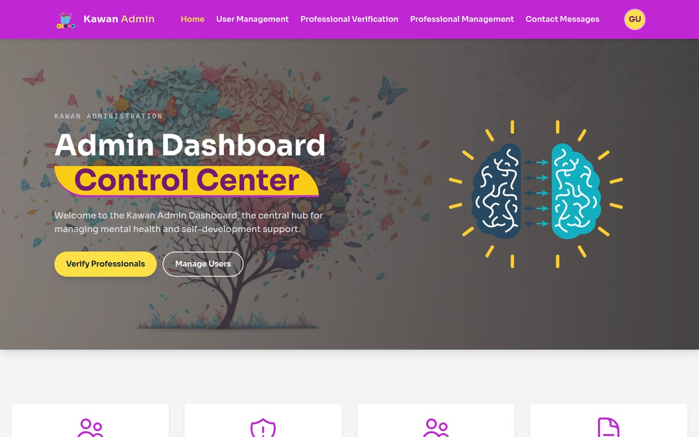
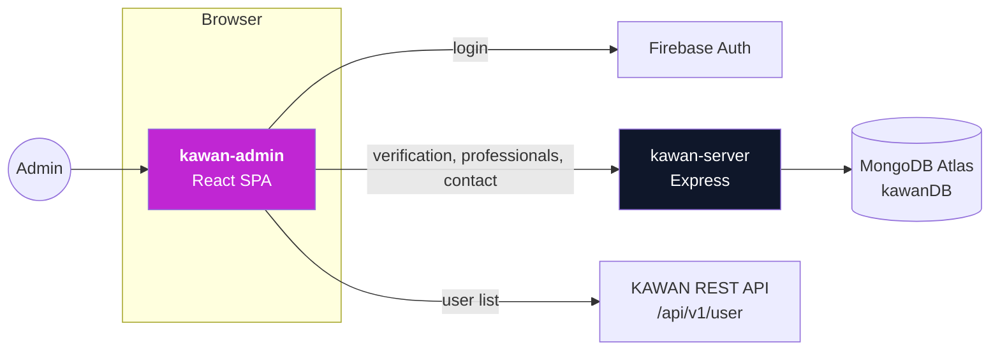
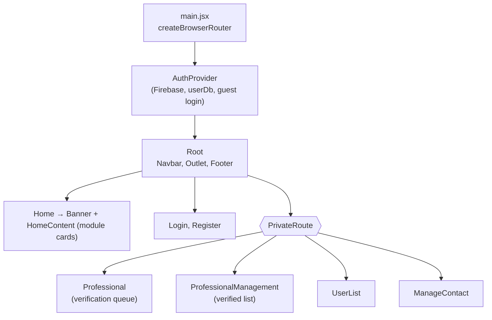
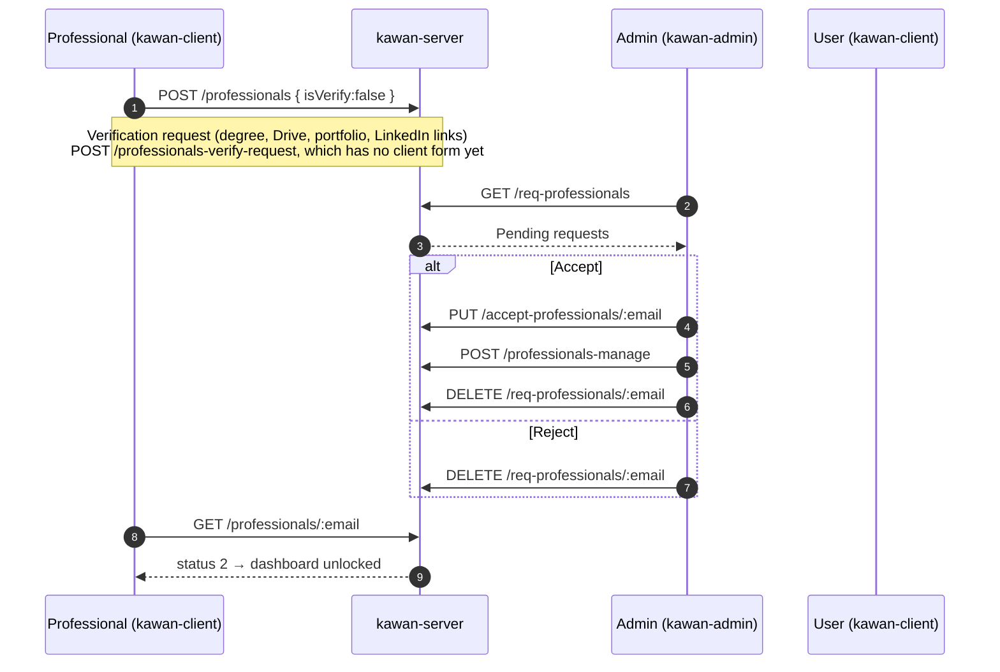
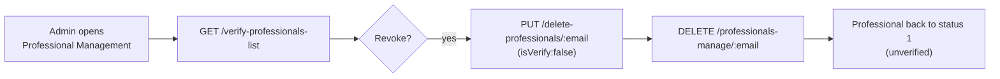
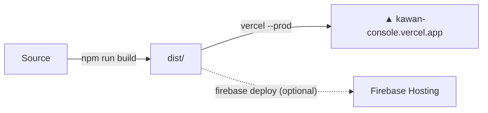

<div align="center">

# KAWAN Admin Console

**Administration panel for KAWAN: verify mental-health professionals, manage users and review contact messages.**

[](https://kawan-console.vercel.app)
[](https://react.dev)
[](https://vitejs.dev)
[](https://tailwindcss.com)
[](https://firebase.google.com)

</div>

---

## Table of Contents

- [Overview](#overview)
- [Live Demo](#live-demo)
- [Screenshots](#screenshots)
- [Features](#features)
- [Tech Stack](#tech-stack)
- [Architecture](#architecture)
- [Workflows](#workflows)
- [Routes](#routes)
- [API Usage](#api-usage)
- [Project Structure](#project-structure)
- [Getting Started](#getting-started)
- [Environment Variables](#environment-variables)
- [Deployment](#deployment)
- [Known Limitations](#known-limitations)
- [Related Repositories](#related-repositories)
- [License](#license)
- [Author](#author)

---

## Overview

KAWAN only lets **verified** professionals offer counselling to users. `kawan-admin` is the back-office app where administrators:

1. review verification requests from professionals (degree details, documents, portfolio and LinkedIn links),
2. **approve or reject** them, and revoke verification later if needed,
3. browse registered users, and
4. read and clear "Contact Us" messages.

All data operations go through [kawan-server](https://github.com/mahfuzhasanreza/kawan-server) (MongoDB), except the user list, which comes from the KAWAN REST API (`kawan.onrender.com/api/v1/user`).

---

## Live Demo

| Environment | URL |
|---|---|
| **Production (Vercel)** | https://kawan-console.vercel.app |

> **Demo access:** on the login page click **Continue as Guest (Demo)** to sign in with the shared demo account (`guest@kawan-demo.com`).

---

## Screenshots



---

## Features

| Module | What the admin can do |
|---|---|
| **Dashboard** | Cards that link to every admin module |
| **Professional Verification** | See pending requests → **Accept** (marks `isVerify: true` and adds to the verified list) or **Reject** (removes the request) |
| **Professional Management** | See all verified professionals → **Revoke** verification |
| **User List** | Browse registered users |
| **Manage Contact** | Read and delete messages sent from the client's Contact Us page |
| **Auth** | Firebase email/password and Google login, guest demo login; every admin page is behind `PrivateRoute` |

---

## Tech Stack

| Layer | Technology |
|---|---|
| UI | React 18, React Router v6 |
| Build | Vite 5 |
| Styling | Tailwind CSS + DaisyUI, Flowbite, Material Tailwind, lucide-react / react-icons |
| Auth | Firebase Authentication |
| Data | fetch / Axios, TanStack React Query |
| Feedback | SweetAlert2, react-hot-toast |
| Hosting | Vercel (primary), Firebase Hosting config included |

---

## Architecture



### Component tree



---

## Workflows

### Verifying a professional (end to end)



### Revoking a professional



---

## Routes

| Path | Component | Access |
|---|---|---|
| `/` | Home: dashboard cards | Public |
| `/login` | Login (email, Google, guest) | Public |
| `/professional-verification` | Pending verification requests | Login required |
| `/professional-management` | Verified professionals | Login required |
| `/user-list` | Registered users | Login required |
| `/manage-contact` | Contact messages | Login required |

---

## API Usage

| Screen | Method & Endpoint | Service |
|---|---|---|
| Verification | `GET /req-professionals` | kawan-server |
| Verification | `PUT /accept-professionals/:email`, `POST /professionals-manage`, `DELETE /req-professionals/:email` | kawan-server |
| Management | `GET /verify-professionals-list`, `PUT /delete-professionals/:email`, `DELETE /professionals-manage/:email` | kawan-server |
| Contact | `GET /contact`, `DELETE /contact/:email` | kawan-server |
| Navbar / Banner | `GET /professionals/:email` (role badge) | kawan-server |
| User list | `GET /api/v1/user` | KAWAN REST API |

See every endpoint in the [kawan-server API reference](https://github.com/mahfuzhasanreza/kawan-server/blob/main/docs/API.md).

---

## Project Structure

```
kawan-admin/
├── docs/screenshots/               # Images used in this README
├── public/
├── src/
│   ├── main.jsx                     # Router + providers
│   ├── config.js                    # SERVER_URL, guest credentials
│   ├── firebase.init.js
│   ├── providers/AuthProvider.jsx
│   ├── routes/PrivateRoute.jsx
│   └── components/
│       ├── Home/, HomeContent/, Banner/, HomeBtn/
│       ├── Navbar/, Footer/, Root/, ErrorPage/
│       ├── Login/, Register/
│       ├── Professional/Professional.jsx   # Verification queue
│       ├── ProfessionalManagement.jsx      # Verified list / revoke
│       ├── UserList.jsx
│       └── ManageContact.jsx
├── vercel.json                      # SPA rewrite
├── firebase.json, .firebaserc
├── tailwind.config.js, vite.config.js, eslint.config.js
└── .npmrc                           # legacy-peer-deps=true
```

---

## Getting Started

```bash
git clone https://github.com/mahfuzhasanreza/kawan-admin.git
cd kawan-admin
npm install
# create .env.local (see below)
npm run dev        # → http://localhost:5173 (or 5174 if the client is already running)
```

| Script | Purpose |
|---|---|
| `npm run dev` | Dev server |
| `npm run build` | Production build → `dist/` |
| `npm run preview` | Preview the build |
| `npm run lint` | ESLint |

You also need [kawan-server](https://github.com/mahfuzhasanreza/kawan-server) running. Ports `5173` and `5174` are already in its CORS allow-list.

---

## Environment Variables

Create `.env.local`:

```env
# Firebase (same project as kawan-client, so the accounts are shared)
VITE_apiKey=YOUR_FIREBASE_API_KEY
VITE_authDomain=YOUR_FIREBASE_AUTH_DOMAIN
VITE_projectId=YOUR_FIREBASE_PROJECT_ID
VITE_storageBucket=YOUR_FIREBASE_STORAGE_BUCKET
VITE_messagingSenderId=YOUR_FIREBASE_MESSAGING_SENDER_ID
VITE_appId=YOUR_FIREBASE_APP_ID

# Backend
VITE_SERVER_URL=http://localhost:5000     # prod: https://kawan-server.vercel.app

# Optional demo account
VITE_GUEST_EMAIL=guest@kawan-demo.com
VITE_GUEST_PASSWORD=********
```

> Vite reads env vars at **build time**. Redeploy after you change them. Never commit `.env.local`.

---

## Deployment



```bash
vercel link          # existing project "kawan-admin" (overwrites .env.local, so back it up first)
vercel env add VITE_SERVER_URL production
vercel --prod
```

Remember to keep the admin domain in kawan-server's `CORS_ORIGINS`.

---

## Known Limitations

- **No admin role check.** `PrivateRoute` only checks that someone is logged in, so any account, including the public guest account, can open every admin page. The server's admin endpoints are not protected either. Admin access should be limited to an allow-list or a Firebase custom claim, and the server should check it too.
- **The verification queue is fed manually.** The client's verification form is not built yet, so requests reach `verify-request` only when they are inserted directly into the database.
- **No automated tests.**

---

## Related Repositories

| Repo | Description |
|---|---|
| [kawan](https://github.com/mahfuzhasanreza/kawan) | Monorepo: all apps as submodules, plus SRS, diagrams and research docs |
| [kawan-client](https://github.com/mahfuzhasanreza/kawan-client) | User and professional web app |
| **kawan-admin** | ← you are here |
| [kawan-server](https://github.com/mahfuzhasanreza/kawan-server) | Express + MongoDB API |

---

## License

Released under the [MIT License](LICENSE).

---

## Author

**[Mahfuz Hasan Reza](https://github.com/mahfuzhasanreza)**, Team **Daimyoz**
